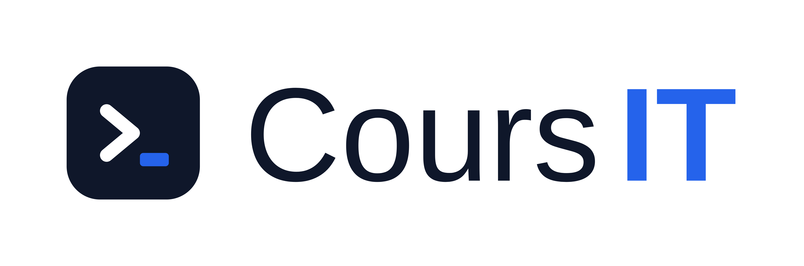

# CoursIT — Plateforme de révision TSSR · AIS · CCNA

Plateforme de formation autonome **single-file** (React 18 + Tailwind via CDN, aucune installation) destinée à préparer les titres professionnels **TSSR (TP-01351)** et **AIS (TP-01352)** ainsi que la certification **Cisco CCNA 200-301**.



## Fonctionnalités

- **Cours & fiches** : parcours TSSR (9 CP), AIS (10 CP) et fiches CCNA v2.0 (sujets 1.1 à 1.7) avec théorie, procédures CLI/GUI, points de vigilance et schémas SVG.
- **Banque QCM** : 3 modes (Entraînement, Chronométré, Révision des erreurs), explications par question, score par CP, erreurs persistées.
- **Labos guidés** : bibliothèque filtrable (parcours / niveau), progression par étapes, marquage terminé, correction complète masquée.
- **Commandes** : classées par fréquence d'usage (TOP indispensables ★★★★★ → ★), filtre par système (Cisco / Windows-PowerShell / Linux), favoris et copie rapide.
- **Glossaire bilingue** (~175 entrées) et **Vocabulaire anglais IT** (~320 termes avec définition, traduction et phrase d'exemple), recherche insensible à la casse et aux accents.
- **Dashboard** : progression par CP, prochaine étape suggérée, suivi QCM, export/import/effacement JSON.
- Thème clair/sombre, réglage de taille de police, navigation mobile, mentions légales RGPD, signalement d'erreur.

## Parcours

| Parcours | Contenu |
|---|---|
| **TSSR** | CP1 centre de services · CP2 Active Directory · CP3 Linux · CP4 réseau TCP/IP · CP5 virtualisation · CP6 scripts · CP7 interconnexion & sécurité · CP8 sauvegarde · CP9 déploiement |
| **AIS** | Durcissement systèmes, supervision, sécurité réseau, PRA/PCA, Cloud & Microsoft 365 |
| **CCNA 200-301** | Sujets 1.1 à 1.7 du domaine 1 (Network Fundamentals), alignés sur le curriculum Cisco (voir `CCNA1` — non inclus dans le dépôt) |

## Installation & lancement

Aucune dépendance. Un serveur HTTP statique suffit (le site utilise localStorage et des CDN).

```bash
# Depuis le dossier du projet
python -m http.server 8741
# puis ouvrir http://localhost:8741/plateforme_de_r_vision_tssr_ais_ccna.html
```

Alternative : `npx serve`, `php -S localhost:8741`, ou tout hébergement statique (GitHub Pages).

## Structure

```
plateforme_de_r_vision_tssr_ais_ccna.html   # Le site complet (données + UI)
logo.png                                     # Logo
audit-contenus.md, suivi-2e-intervention.md  # Suivi pédagogique et technique
```

## Périmètre des données

Toute la progression utilisateur reste **dans le navigateur** (localStorage) :aucune donnée n'est transmise à un serveur. Export/import JSON disponible depuis le Dashboard.

## Sources des contenus

Les contenus pédagogiques ont été rédigés à partir des cours locaux du projet (`cours_IT-main`, `Cours_TSSR-main`) et du curriculum CCNA (référence : *CCNA 1 Introduction to Networks*, Cisco Networking Academy). Les référentiels officiels sont cités, jamais recopiés.

## Contribuer

Le projet est un fichier unique volontairement (facilité de déploiement pédagogique). Pour proposer des ajouts (QCM, labos, termes de vocabulaire), éditer les tableaux `COURSES_DATA`, `LABS_DATA`, `CHEAT_SHEETS`, `GLOSSARY_DATA`, `ENGLISH_VOCAB` dans le fichier HTML.
